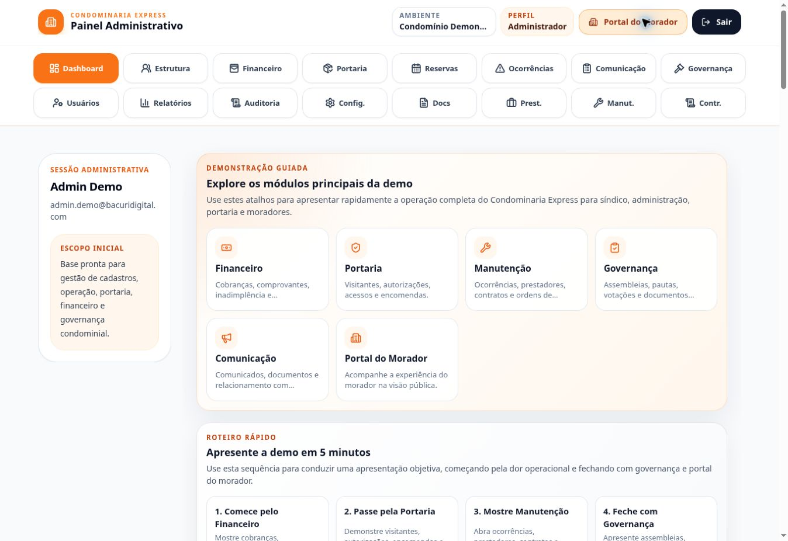
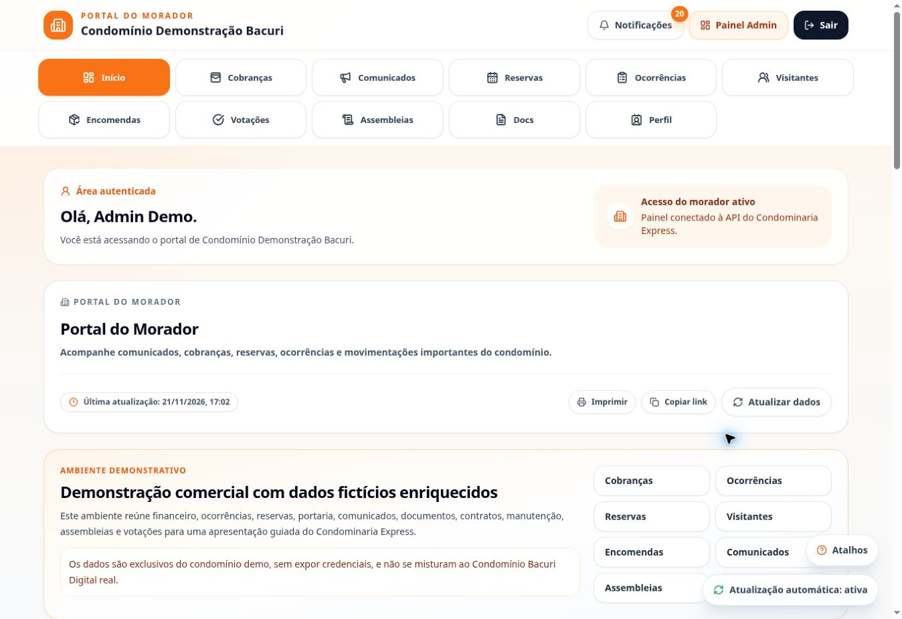
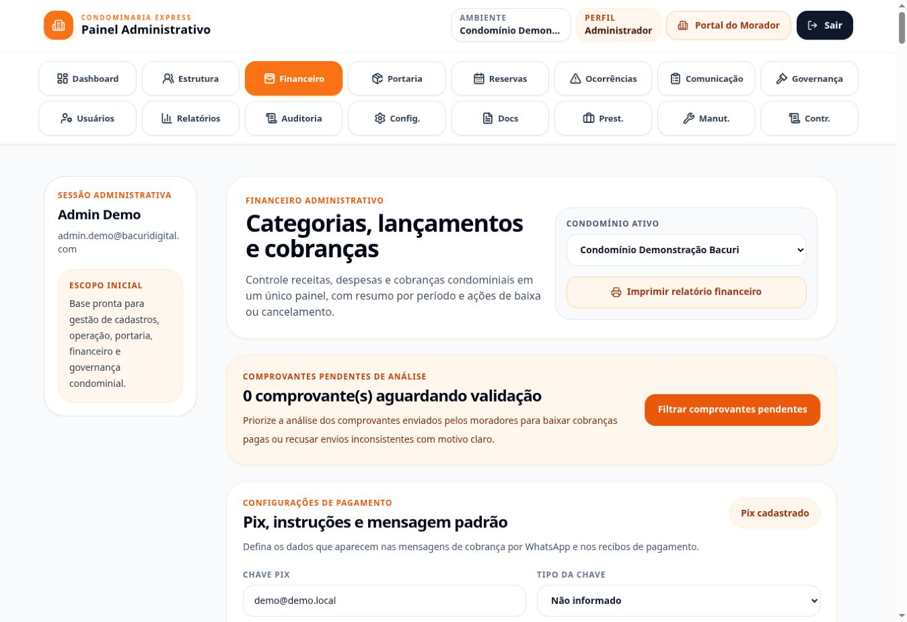
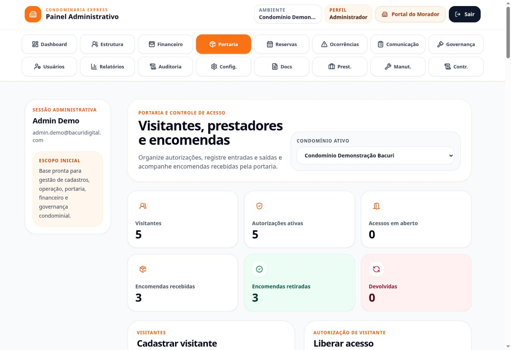
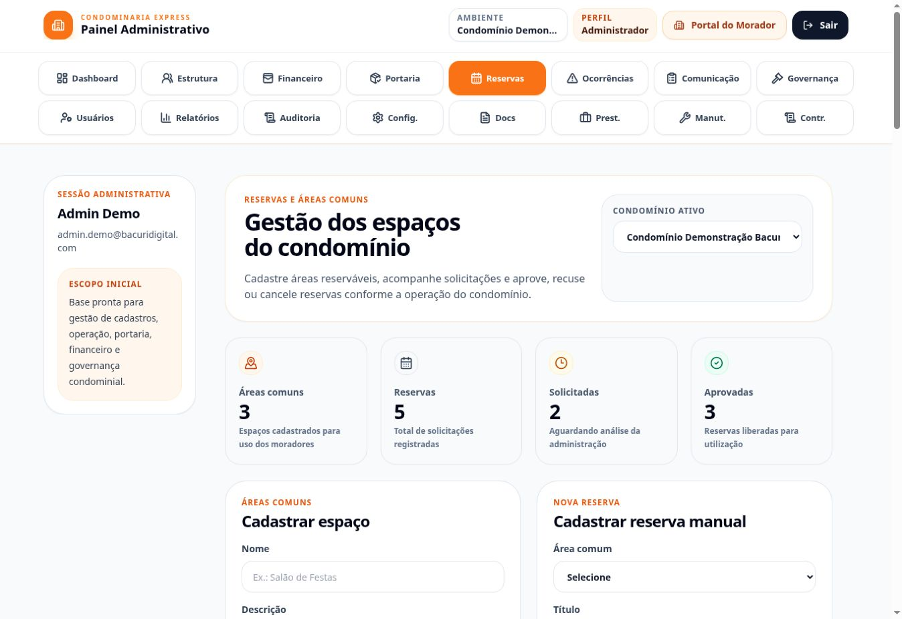
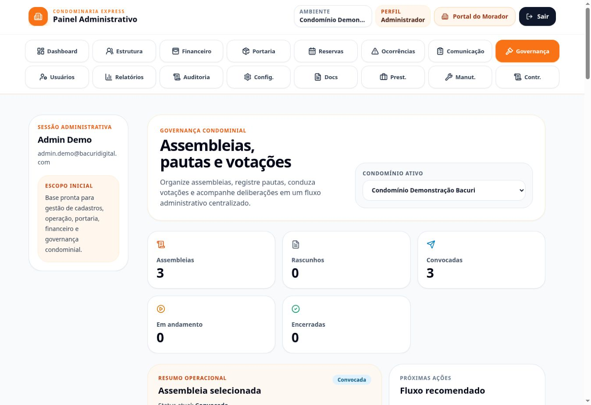

# Condominaria Express

Sistema de gestão de condomínios com painel administrativo e portal do morador. A interface usa React e Vite. A API usa NestJS e Prisma.

## Telas principais

As capturas usam dados fictícios do ambiente de demonstração.

| Painel administrativo | Portal do morador |
| --- | --- |
|  |  |
| Visão geral da operação do condomínio. | Alertas, cobranças, comunicados e serviços da unidade. |

| Financeiro | Portaria |
| --- | --- |
|  |  |
| Categorias, lançamentos e acompanhamento de cobranças. | Visitantes, autorizações de acesso e encomendas. |

| Reservas | Governança |
| --- | --- |
|  |  |
| Espaços comuns, agenda e reservas. | Assembleias, pautas e votações. |

## Frontend

Execute `npm ci` e `npm run build` em `condominaria-express-web/` para gerar o portal. Os atalhos de demonstração aparecem ao configurar os e-mails de teste nas variáveis `VITE_DEMO_EMAIL_*`. Informe a senha no formulário de login.

## Implantação conjunta na Hostinger

Use a raiz do repositório (`./`), npm, Node.js 22 ou 24, o comando de build `npm run build` e o arquivo de entrada `server.js`. O build gera o cliente Prisma, compila a API e inclui o frontend na saída servida pelo NestJS.

Configure `DATABASE_URL` e `JWT_SECRET` nas variáveis de ambiente do site. A raiz redireciona para `/portal/` e o frontend usa `/api` na mesma origem. Após implantar, confira `/api/health`, abra `/portal/login` e teste o login.
